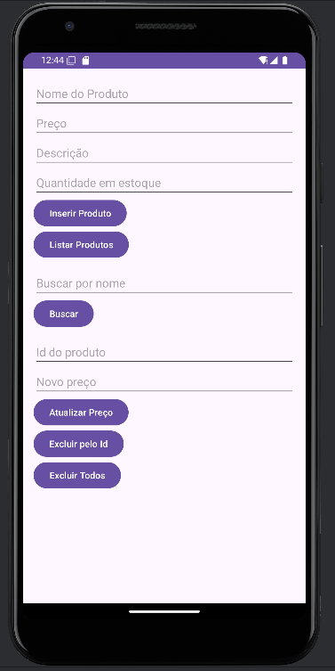
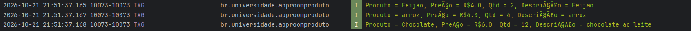
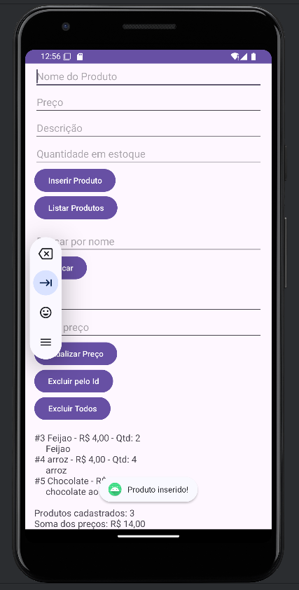
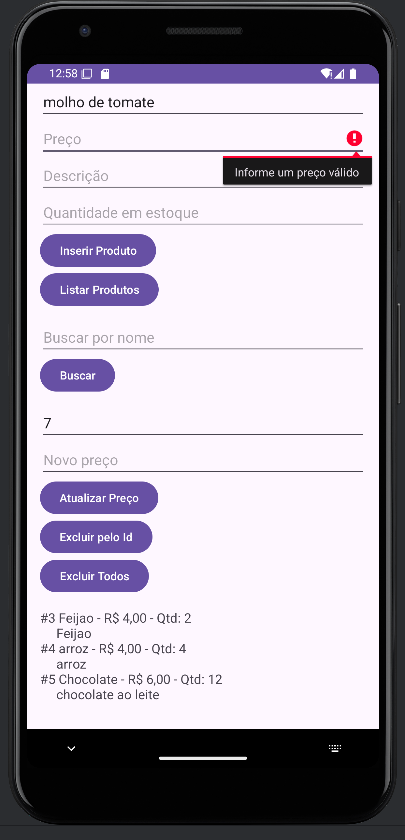
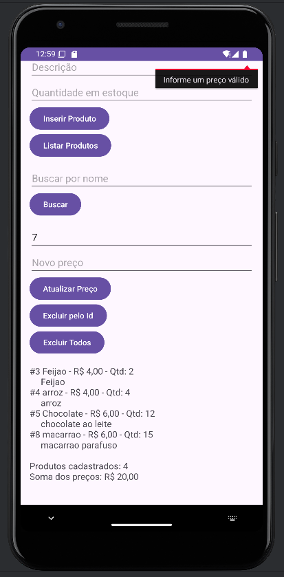
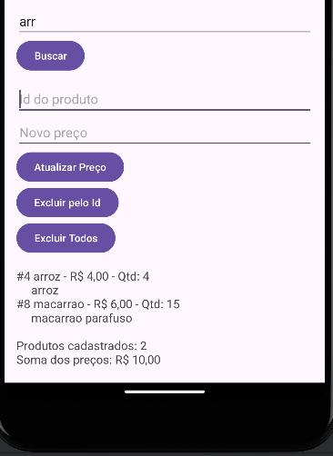
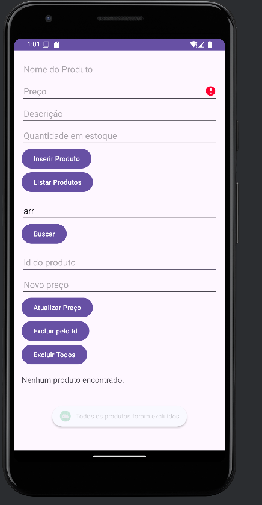
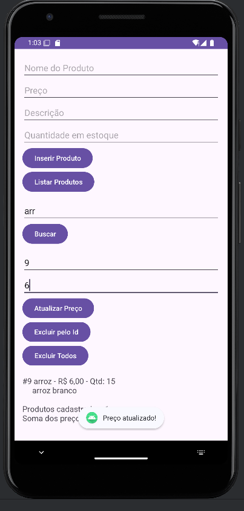
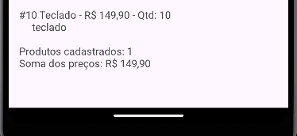

    # AppRoomProduto: Cadastro de Produtos com Room SQLite

**Aluno(a):** Micaias Emanuel, Yuri Andrey
**RA:** 240022, 240120
**Disciplina:** Programação para Dispositivos Móveis
**Professor(a):** Alessandro

## Sobre o projeto

Aplicativo Android em Kotlin que cadastra e lista produtos
usando persistência local com Room (SQLite). Além do cadastro e da listagem
do tutorial, o app permite validar preço, buscar por nome, atualizar o preço,
excluir produtos e controlar a quantidade em estoque.

## Tecnologias

- Kotlin
- Room 2.6.1 (SQLite)
- ViewBinding
- Corrotinas (lifecycleScope)

## Prints do app





## Parte A: Complemento prático

### A1. Limpar campos após inserir

**O que foi feito:** depois que o produto é gravado com sucesso, os campos de texto são esvaziados com `clear()` e o cursor volta para o campo Nome com `requestFocus()`. Isso fica dentro do `lifecycleScope.launch`, logo após o `insertAll`, para só limpar quando a gravação deu certo.

**Trecho de código:**

```kotlin
lifecycleScope.launch {
    productDao.insertAll(product)
    Toast.makeText(this@MainActivity, "Produto inserido!", Toast.LENGTH_SHORT).show()

    binding.editProductName.text.clear()
    binding.editProductPrice.text.clear()
    binding.editProductDescription.text.clear()
    binding.editProductQuantity.text.clear()
    binding.editProductName.requestFocus()
}
```

**Print:** 

### A2. Validação de preço

**O que foi feito:** o texto do preço é convertido com `toDoubleOrNull()`. Se o resultado for nulo (campo vazio ou texto inválido) ou menor ou igual a zero, o produto não é salvo e o erro aparece no próprio campo. O `return@setOnClickListener` interrompe o clique antes de chegar ao banco. Também troquei a vírgula por ponto, para aceitar valores como `149,90`.

**Trecho de código:**

```kotlin
val price = priceText.replace(",", ".").toDoubleOrNull()
if (price == null || price <= 0.0) {
    binding.editProductPrice.error = "Informe um preço válido"
    return@setOnClickListener
}
```

**Print:** 

### A3. Lista na tela

**O que foi feito:** adicionei um `TextView` (`txtResultado`) abaixo dos botões. Ao clicar em Listar Produtos, a função `mostrarProdutos()` monta o texto com uma linha por produto e o exibe na tela. O Logcat continua recebendo os mesmos dados.

**Trecho de código:**

```kotlin
val linhas = products.joinToString("\n") {
    "#${it.id} ${it.name} - ${formatarPreco(it.price)} - Qtd: ${it.quantity}\n" +
        "     ${it.description ?: ""}"
}
binding.txtResultado.text = linhas
```

**Print:** 

### A4. Total do estoque

**O que foi feito:** junto da lista, o app mostra quantos produtos existem (`products.size`) e a soma dos preços (`products.sumOf { it.price }`), formatada em reais com duas casas decimais.

**Trecho de código:**

```kotlin
val total = products.sumOf { it.price }

binding.txtResultado.text =
    "$linhas\n\n" +
        "Produtos cadastrados: ${products.size}\n" +
        "Soma dos preços: ${formatarPreco(total)}"
```

**Print:** 

### A5. Buscar por nome

**O que foi feito:** criei no DAO a função `buscarPorNome`, com `LIKE`. Na tela há um campo de busca e o botão Buscar. O texto é envolvido por `%` para encontrar nomes que contenham o trecho digitado (por exemplo, "tec" encontra "Teclado").

**Trecho de código:**

```kotlin
// ProductDao.kt
@Query("SELECT * FROM product WHERE name LIKE :nome")
suspend fun buscarPorNome(nome: String): List<Product>

// MainActivity.kt
binding.btnBuscar.setOnClickListener {
    val texto = binding.editBusca.text.toString().trim()
    lifecycleScope.launch {
        mostrarProdutos(productDao.buscarPorNome("%$texto%"))
    }
}
```

**Print:** 

### A6. Excluir produtos

**O que foi feito:** criei `deleteAll()` com `@Query("DELETE FROM product")` e o botão Excluir Todos. Para o desafio extra, usei `@Delete` com um botão Excluir pelo Id: o app busca o produto pelo id informado e, se ele existir, o remove.

**Trecho de código:**

```kotlin
// ProductDao.kt
@Query("DELETE FROM product")
suspend fun deleteAll()

@Delete
suspend fun delete(product: Product): Int

// MainActivity.kt
binding.btnExcluirTodos.setOnClickListener {
    lifecycleScope.launch {
        productDao.deleteAll()
        mostrarProdutos(emptyList())
    }
}
```

**Print:** 

### A7. Atualizar produto

**O que foi feito:** adicionei `@Update` no DAO e dois campos na tela (Id e Novo preço) com o botão Atualizar Preço. O app busca o produto com `getById`, cria uma cópia com o preço novo usando `copy(price = novoPreco)` e chama `update`. Se o id não existir, mostra "Produto não encontrado". O novo preço passa pela mesma validação do A2.

**Trecho de código:**

```kotlin
// ProductDao.kt
@Update
suspend fun update(product: Product): Int

// MainActivity.kt
lifecycleScope.launch {
    val produto = productDao.getById(id)
    if (produto == null) {
        Toast.makeText(this@MainActivity, "Produto não encontrado", Toast.LENGTH_SHORT).show()
    } else {
        productDao.update(produto.copy(price = novoPreco))
        mostrarProdutos(productDao.getAll())
    }
}
```

**Print:** 

### A8. Novo campo na tabela (`quantity`)

**O que foi feito:** adicionei `quantity: Int` na entidade `Product`, um campo "Quantidade em estoque" no layout e aumentei `version` de 1 para 2 no `@Database`. A quantidade aparece na listagem.

**Trecho de código:**

```kotlin
// Product.kt
@ColumnInfo(name = "quantity") val quantity: Int = 0

// AppDatabase.kt
@Database(entities = [Product::class], version = 2)
```

**O que aconteceu com os produtos já cadastrados e por quê:** eles foram apagados. O Room guarda a versão do banco no arquivo SQLite. Ao abrir o app com `version = 2`, ele percebeu que o arquivo ainda estava na versão 1 e que não existia uma `Migration` ensinando como passar de uma versão para a outra. Como o projeto usa `fallbackToDestructiveMigration()`, o Room resolveu isso apagando as tabelas antigas e recriando o banco já com a coluna `quantity`. Por isso a lista veio vazia depois da atualização. Sem o `fallbackToDestructiveMigration()` e sem uma `Migration`, o app fecharia com um erro de `IllegalStateException`, dizendo que a migração de 1 para 2 não foi encontrada.

**Print:** 

## Parte B: Questões dissertativas

### B1. O que é persistência de dados? O que aconteceria com os produtos se fossem guardados apenas em uma MutableList dentro da MainActivity?

**Resposta:** Persistência de dados é guardar as informações de um jeito que elas continuem existindo depois que o app fecha ou o celular desliga. No meu projeto, o Room salva os produtos em um arquivo SQLite dentro do celular, então quando eu fecho o app e abro de novo, o botão Listar Produtos ainda mostra tudo que cadastrei. Se eu usasse só uma `MutableList` dentro da `MainActivity`, os produtos ficariam apenas na memória RAM. Eles sumiriam quando o app fosse fechado e até quando a tela girasse e a Activity fosse recriada. Ou seja, a pessoa cadastraria tudo e perderia na próxima vez que abrisse o app.

### B2. Qual é a diferença entre usar o SQLite diretamente e usar o Room? Cite pelo menos duas vantagens do Room.

**Resposta:** No SQLite puro, com o `SQLiteOpenHelper`, eu teria que escrever todo o SQL na mão (criar tabela, inserir, consultar) e transformar cada linha do `Cursor` em objeto manualmente, o que dá bastante trabalho e erro. O Room fica por cima do SQLite e faz muito disso por mim. Uma vantagem é que ele confere as consultas na hora de compilar, então se eu errar o nome de uma tabela ou coluna o erro aparece no build e não com o app rodando. Outra vantagem é que ele gera o código repetitivo: com `@Insert`, `@Update` e `@Delete` não preciso escrever o SQL, e o resultado das consultas já volta como objetos `Product`. Ele também funciona com `suspend`, o que ajuda a não travar a tela.

### B3. Explique o papel de Entity, DAO e Database. Como elas se relacionam no seu projeto?

**Resposta:** A Entity é a classe que vira uma tabela. No meu projeto é a `Product`, e cada atributo (`id`, `name`, `price`, `description` e `quantity`) vira uma coluna. O DAO é a interface com as operações que posso fazer no banco, como listar, inserir, buscar por nome, atualizar e excluir, que estão no `ProductDao`. O Database é a classe `AppDatabase`, que junta tudo: diz quais entidades existem, qual é a versão do banco e entrega o DAO pelo `productDao()`. Na prática, a `MainActivity` cria o banco com o `Room.databaseBuilder`, pega o DAO dele e usa o DAO para salvar e ler os objetos `Product`.

### B4. Por que o Android não permite acessar o banco na thread principal? O que é um ANR? Como suspend e lifecycleScope.launch resolvem esse problema?

**Resposta:** A thread principal é a que desenha a tela e responde aos toques. Acessar o banco é lento porque mexe com disco, e se isso acontecesse nela o app ficaria travado até terminar. Por isso o Room não deixa e dá o erro "Cannot access database on the main thread". Se a thread principal fica presa por tempo demais, o Android mostra o ANR (Application Not Responding), aquela mensagem de que o app não está respondendo. No meu projeto as funções do DAO são `suspend` e eu chamo elas dentro do `lifecycleScope.launch`. Assim o banco trabalha em segundo plano, a tela continua livre, e a corrotina é cancelada sozinha se a Activity for fechada.

### B5. O que faz o fallbackToDestructiveMigration()? Por que ele é perigoso em um app publicado? O que seria uma Migration?

**Resposta:** O `fallbackToDestructiveMigration()` diz ao Room que, se a versão do banco mudar e eu não tiver ensinado como migrar, ele pode apagar as tabelas e criar tudo de novo vazio. Foi o que aconteceu no A8, quando mudei a versão para 2 e os produtos sumiram. Em desenvolvimento isso quebra um galho, mas em um app publicado na Play Store é perigoso, porque a cada atualização o usuário poderia perder todos os dados que guardou, sem aviso. Uma Migration é justamente o jeito certo: é um código que explica como passar o banco de uma versão para a outra mantendo os dados, por exemplo adicionando a coluna `quantity` com `ALTER TABLE` sem apagar nada.

### B6. Qual é a vantagem do ViewBinding em relação ao findViewById? Que tipo de erro ele ajuda a evitar?

**Resposta:** Com o `findViewById` eu preciso procurar cada componente pelo id, e o compilador não avisa se o id não existe ou se o tipo está errado. Com o ViewBinding o Android cria uma classe para o layout (no meu projeto, a `ActivityMainBinding`) e eu acesso os componentes direto, como `binding.btnInserirProduto`, já com o tipo certo. Ele ajuda a evitar erros como usar um id que não existe ou tratar um `EditText` como se fosse um `Button`, que no `findViewById` só apareciam com o app rodando, muitas vezes como `NullPointerException`. Além disso, o código fica mais curto e mais fácil de ler.

### B7. Por que em apps maiores é recomendado criar o banco como Singleton? O que poderia acontecer se várias telas criassem cada uma o seu banco?

**Resposta:** Criar uma instância do banco é pesado, porque ela abre a conexão com o arquivo e guarda vários recursos. Por isso, em apps maiores é melhor ter uma única instância (Singleton) que todas as telas compartilham. No tutorial o banco é criado na `MainActivity`, o que funciona porque o app tem só uma tela. Se cada tela criasse o seu próprio banco, o app gastaria memória e conexões à toa, e as instâncias não saberiam das mudanças umas das outras, então uma tela poderia mostrar dados desatualizados. Também aumentaria o risco de conflito ao gravar no mesmo arquivo ao mesmo tempo.

### B8. Reflexão pessoal: dificuldades e exemplo de aplicação

**Resposta:**

**Dificuldades e como resolvi:** Minha maior dificuldade foi um erro de versão no Gradle. Ao sincronizar o projeto, apareceu a mensagem “2 issues were found when checking AAR metadata”: as bibliotecas core e core-ktx 1.17.0 exigiam o Android Gradle Plugin 8.9.1 ou superior, e meu projeto usava a 8.5.1. Resolvi mudando a versão do coreKtx no arquivo libs.versions.toml para 1.13.1, e depois disso o Sync passou e o app compilou.

**Exemplo de aplicação:** eu usaria o Room em um app de controle de estoque para uma lojinha de bairro. O dono cadastraria cada produto com nome, preço e quantidade, igual a este projeto, e tudo ficaria salvo no próprio celular, funcionando mesmo sem internet, o que é importante para um comércio pequeno. Eu usaria a busca por nome para achar um item rápido no balcão, o `@Update` para acertar preço e quantidade quando chega mercadoria ou acontece uma venda, e a soma dos valores para ter uma ideia do total em estoque.

## Como executar

1. Clone o repositório
2. Abra no Android Studio
3. Execute em um emulador (API 24+)
